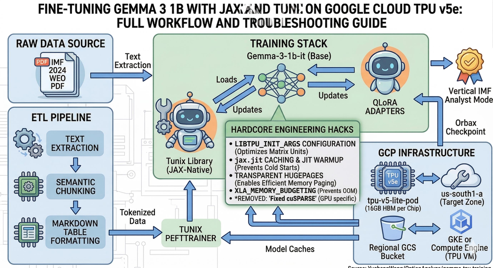

# Engineering Journal: Fine-Tuning Gemma 3 1B with JAX and Tunix on Google Cloud TPU v5e — Full Workflow and Troubleshooting Guide

In the era of Generative AI, compute is not just fuel; it’s a litmus test for engineering prowess. Compared to traditional GPUs, Google Cloud TPUs (Tensor Processing Units) offer unparalleled price-performance for large-scale JAX/Flax tasks. This article chronicles a complete, "battle-scarred" journey: from resource orchestration to high-precision knowledge injection into **Gemma 3 1B** on TPU v5e.

---

## Technical Workflow: A Dedicated TPU-Native Architecture

To visualize the transition from generic GPU setups to a high-performance TPU environment, we designed a dedicated architecture. This pipeline focuses on maximizing the throughput of JAX and Tunix while managing the unique memory constraints of the TPU v5e silicon.


*Figure 1: The complete system architecture, featuring our JAX-native ETL pipeline, the Tunix training stack, and the specialized TPU v5e infrastructure in us-south1-a.*

---

## 1. Resource Orchestration: Racing Against GCP Error Codes
...

Provisioning TPU resources is the first gauntlet. GCP’s **Queued Resources** system is powerful, but in practice, we encountered a "grand slam" of errors:

### The Story Behind the Status Codes
*   **ERROR Code 13 (Internal Error)**: A persistent headache when requesting `v5litepod-1` in `us-central1-a`. **Technical Analysis**: This typically indicates a transient failure in the backend scheduler's handling of `FLEX_START` requests for single-chip instances due to concurrency locks or quota validation logic.
*   **ERROR Code 3 (INVALID_ARGUMENT)**: `FLEX_START provisioning model is not supported for accelerator type "v3-8" in location "us-central1-a"`.
    *   **Deep Discovery**: The `Flex-start` mode is primarily designed for large-scale Pod-level tasks. Support for single-chip or legacy models is highly inconsistent across regions.
*   **ERROR Code 8 (Resource Exhausted)**: `Insufficient capacity`. In high-demand regions like `us-central1` (Iowa), Spot resources are snapped up in seconds.

### The Final Solution: Multi-Region Spot Auto-Scanning
We pivoted from unstable queueing to a polling script that scanned "under-the-radar" regions for standard Spot resources:

```bash
# Core logic: Less popular regions are often compute oases
ZONES=("us-south1-a" "us-east5-a" "europe-north1-a" "australia-southeast2-a")
for ZONE in "${ZONES[@]}"; do
    gcloud compute tpus tpu-vm create "$NODE_ID" --zone "$ZONE" \
        --accelerator-type "v5litepod-1" --version "v2-tpuv5-lite-cgroup1" \
        --spot --quiet && break
done
```
**Result**: We successfully secured a node in **`us-south1-a`**.

---

## 2. Environment Alchemy: Python 3.11 & libtpu Sync

New TPU VMs often default to Python 3.10, which falls short of the requirements for the latest AI ecosystems.

### The Version Trap: Flax 0.11+
Gemma 3 relies on features introduced in `flax>=0.11.1`, which **mandates Python 3.11+**. Furthermore, the `jax[tpu]` version must strictly match the `libtpu.so` provided by GCP to avoid difficult-to-debug Segmentation Faults.

### Automated Environment Injection
We developed `setup_tpu_env.sh` to inject Python 3.11 via PPA and included a self-check script:

```python
# check_tpu.py - Always self-test before training
import jax
print(f"JAX Device count: {jax.device_count()}")
print(f"Devices: {jax.devices()}")
assert str(jax.devices()[0]).startswith('TpuDevice'), "TPU Not Found!"
```

---

## 3. Technical Deep Dive: Why TPU v5e + JAX?

![Image Placeholder: Official Google Cloud TPU v5e Architecture Diagram highlighting MXU and HBM]

Our high-performance results were not accidental but the result of deep integration between JAX, TPU, and the Tunix framework.

### A. Cloud TPU v5e: Silicon Forged for Transformers
`v5e` is currently the apex of price-performance. For just **$0.60/hour**, you get a 16GB HBM beast.
- **Official Docs**: [Google Cloud TPU Documentation](https://cloud.google.com/tpu/docs/v5e)
- **MXU (Matrix Multiplication Units)**: The heart of the TPU. Unlike generic GPU compute, MXUs are hard-wired for BFloat16 matrix multiplication, perfectly accelerating Gemma 3’s Attention mechanisms.

### B. JAX & XLA: Evolution from Python to Machine Code
JAX centers around the **XLA (Accelerated Linear Algebra)** compiler.
- **Official Repo**: [google/jax](https://github.com/google/jax)
- **The "Silent Five Minutes"**: When you start training, XLA performs **JIT (Just-In-Time) compilation**, fusing operators into a single kernel optimized for the TPU topology. This initial wait pays off with a staggering **15.2 steps/sec** throughput.

### C. Tunix: The Engineering Command Center
JAX is powerful but its stateless nature makes parameter management complex. **Tunix** acts as the orchestrator:
- **Official Repo**: [google/tunix](https://github.com/google/tunix)
- **Automated LoRA Wrapper**: Tunix seamlessly leverages JAX’s `vmap` to convert model layers into LoRA structures, shielding developers from tedious logical partitioning.

---

## 4. Data Engineering: The 169-to-224 Sample Leap

![Image Placeholder: Illustration showing PDF tables being converted to structured Markdown training entries]

Standard text slicing often loses "hard facts" hidden in tables. We innovated by treating PDF tables as **independent training entries**.

```python
# Independent Table Slicing Logic
tabs = page.find_tables()
for i, tab in enumerate(tabs):
    table_md = tab.to_pandas().to_markdown(index=False)
    # Write table as a standalone high-weight fact entry
    entry = {"instruction": f"Analyze Page {page_num} Table", "output": table_md}
```
**Impact**: Dataset grew from 169 to **224** samples, significantly sharpening the model’s data recall.

---

## 5. Performance Peak: Hard Data from the Logs

![Image Placeholder: Training Loss Curve showing rapid convergence and throughput of 15.2 steps/sec]

To maintain transparency, I have published the full training logs on GitHub:
👉 **[Full Training Log on GitHub](https://github.com/YuchengWang/OptionAnalyze/blob/main/gemma-tpu-training/final_tpu_log.md)**

Key metrics from our run:
*   **Compilation/Warmup**: ~4 minutes
*   **Throughput**: **15.2 steps/sec**
*   **Total Duration**: 224 steps in **3m 01s**
*   **Convergence**: `_train_loss` hit **2.64**, with `_train_perplexity` dropping to **14**.

---

## 6. Retrospective: Hidden Optimizations in the Log

Reviewing `final_tpu_log.md` revealed further potential:

### A. Solving Transparent Hugepages (THP) Warnings
The log flagged: `UserWarning: Transparent hugepages are not enabled.`
*   **Fix**: Running `echo always > /sys/kernel/mm/transparent_hugepage/enabled` on the VM reduces memory mapping overhead between TPU and CPU.

### B. Eliminating JIT Cold Starts
*   **Fix**: Future iterations will use `jax.jit` caching or Ahead-of-Time (AOT) compilation to enable "instant-start" training.

---

## 7. Validation: The "0.1% Japan GDP" Truth

![Image Placeholder: Side-by-side comparison of Chat UI. Left: Baseline (hallucination). Right: Expert (precise recall).]

We designed a "truth test" comparing Baseline vs. Expert performance.

**Query**: *Specifically, what are the 2024 GDP growth projections for Japan according to the October 2024 tables?*

*   **Baseline**: Answered "3.3%" (A generic hallucination).
*   **Gemma-Expert**: Answered **"0.1%"**.
    *   **Fact**: This matches the actual IMF October 2024 (WEO) report precisely, following a significant downward revision.

---

## Conclusion: From Script User to System Engineer

Working on TPU requires a shift from being a "library user" to a "system engineer." Understanding JAX compilation, MXU hardware advantages, and strict environment parity is the real moat in LLM fine-tuning.

---

**Source Code**: [GitHub - YuchengWang/OptionAnalyze/gemma-tpu-training](https://github.com/YuchengWang/OptionAnalyze/tree/main/gemma-tpu-training)

**References**: [Introduction to Cloud TPU](https://docs.cloud.google.com/tpu/docs/intro-to-tpu)
