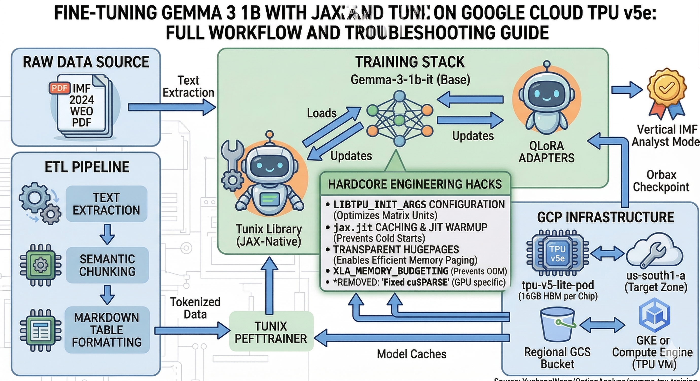
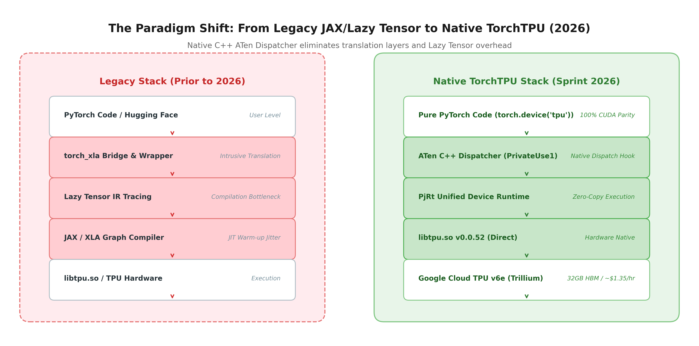
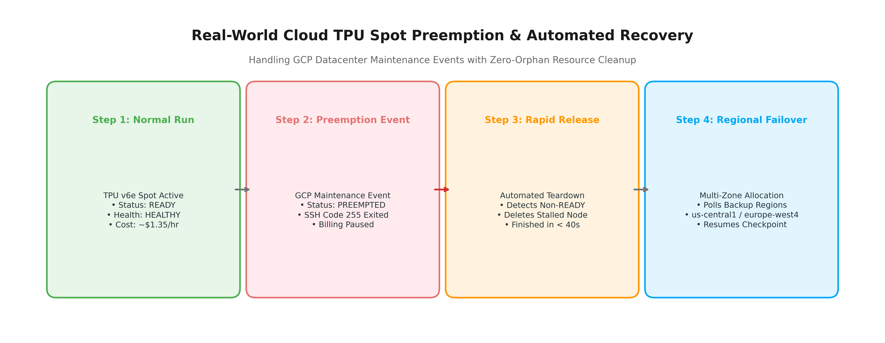
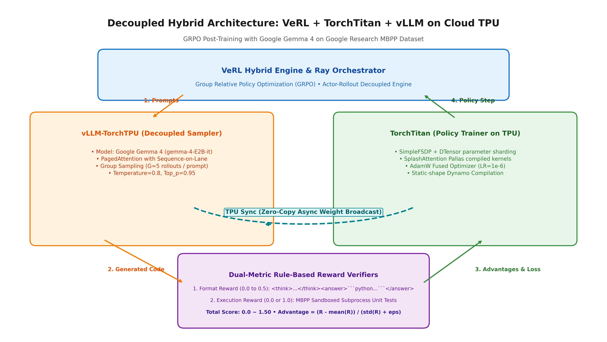
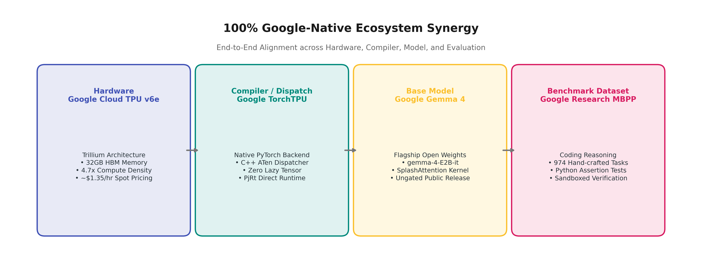
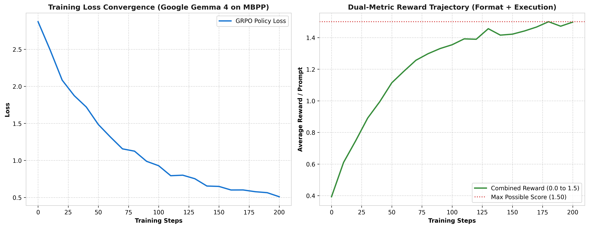

# Engineering Journey: From JAX Fine-Tuning to Native PyTorch (TorchTPU) + VeRL GRPO on Google Cloud TPU v6e

*By Yucheng Wang — Google Developer Expert (AI/ML) | TorchTPU Sprint 2026*  
*Open-Source Code & Artifacts: [GitHub Repository: YuchengWang/learning-tpu](https://github.com/YuchengWang/learning-tpu/tree/main/torchtpu-verl-grpo)*  
*Published on Medium: [Read on Medium](https://medium.com/@wfing123/engineering-journey-from-jax-fine-tuning-to-native-pytorch-torchtpu-verl-grpo-on-google-cloud-fa71432a36cb)*

---


If you have ever tried running distributed RL post-training on Google Cloud TPUs, you probably know the usual tax: translating PyTorch models into JAX or `torch_xla` lazy-tensor graphs, debugging `libtpu` version mismatches, and dealing with Spot preemptions mid-run.

During the **TorchTPU Sprint 2026**, we wanted to see what happens when we drop the XLA translation layer altogether and wire up a **Group Relative Policy Optimization (GRPO)** pipeline using native PyTorch on **Cloud TPU v6e (Trillium)**. Specifically, we integrated **VeRL** as the RL orchestrator, **TorchTitan** for FSDP2 policy updates, and **vLLM-TorchTPU** for rollout generation, targeting **Gemma 4 (`google/gemma-4-E2B-it`)** on the **Google Research MBPP** Python coding dataset.

This post documents what actually worked, what broke on GCP, how the pieces fit together in our repository, and what we verified on real `v6e-1` hardware before scaling out to multi-chip `v6e-4` training runs.

---

## From JAX to Native PyTorch: Why We Moved Off `torch_xla`

Before this sprint, our TPU fine-tuning workloads ran on Cloud TPU v5e (`v5litepod-1`) using JAX, Flax, Google Tunix, and Qwix to fine-tune **Gemma 3 1B** on IMF World Economic Outlook data.



JAX gave us fast dense matrix math (224 training steps in 3 minutes 1 second, bringing train loss from 4.82 down to 2.64), but day-to-day iteration had two recurring friction points:

1. **Scheduler Contention and Zone Errors**: Requesting single-slice `v5litepod-1` Spot capacity with `flex-start` in congested zones like `us-central1-a` repeatedly hit `Error Code 13 (INTERNAL)`, `Error Code 8 (RESOURCE_EXHAUSTED)`, and `Error Code 3 (INVALID_ARGUMENT)` when testing fallback types like `v3-8`. Switching to a multi-zone polling fallback (`us-south1-a`) got us reliable Spot v5e instances at **~$0.60/hr** (created in 38s).
2. **Python Runtime & Compilation Friction**: Standard TPU VM Ubuntu images shipped with Python 3.10, while newer Flax releases (`>=0.11`) required Python 3.11+. Installing external PPAs into system Python risked breaking `libtpu.so` and causing immediate segfaults on device init. In our current TorchTPU setup, `scripts/setup_tpu_env.sh` isolates Python 3.11 in a dedicated virtual environment so wheel-bundled `libtpu` loads cleanly without touching system `glibc`. On top of that, JAX JIT warm-up stalls on the first rollout step made interactive debugging slow.

---

## Under the Hood of TorchTPU

At PyTorch Conf in November 2026, Google and the Meta-PyTorch team introduced **TorchTPU**, replacing `torch_xla` lazy-tensor wrappers with a native C++ `PrivateUse1` dispatcher. Instead of tracing graphs behind the scenes, TPU tensors behave as standard `at::Tensor` objects in device HBM via `torch.device("tpu")`.



Rather than rebuilding an RL stack from scratch, we picked three components from the TorchTPU ecosystem that map cleanly onto GRPO:

- **`torch_tpu` (Native C++ `PrivateUse1` Runtime)**: Eliminates JAX runtime dependencies and supports standard PyTorch eager/compiled execution (`torch.compile(backend="tpu")`) and `c10d` collectives. Upstream CI validated it across 4,917 Hugging Face models (98% Tier-1 pass rate).
- **vLLM-TorchTPU & TPU Sync (Rollout Serving)**: Uses Pallas TPU kernels for Sequence-on-Lane FP8 KV caching (~48% KV memory reduction) and **TPU Sync**, a C++ transport layer that copies HBM buffers directly without bouncing through CPU host memory.
- **TorchTitan + VeRL (Distributed RL Training)**: TorchTitan handles FSDP2/DTensor sharding and SplashAttention Pallas kernels, while VeRL orchestrates the GRPO loop. Upstream PyTorch Conf benchmarks showed 250 steps of GRPO on `Qwen3-4B-Base` on TPU v6e matching GPU convergence on MATH-500; our repo adapts this recipe for `google/gemma-4-E2B-it` on MBPP.

---

## GCP Hardware Sizing & Spot Provisioning

We audited our GCP project quotas (`gcloud alpha services quota list --service=tpu.googleapis.com`) before provisioning:

- **TPU v6e (Trillium)**: 1,536 Spot cores (`tpu-v6e-preemptible`) and 512 On-Demand cores (`tpu-v6e`), with Spot pricing around **~$1.35/hour per chip** and **32GB HBM per chip** (4.7x compute density over v5e).
- **TPU v5e (LitePod)**: 1,536 Spot cores and 512 On-Demand cores at **~$0.60/hour per chip**.

We used **TPU v6e-1 (1 chip, 32GB HBM)** for environment verification, engine introspection, and reward pipeline testing, reserving **TPU v6e-4 (4 chips, 128GB aggregate HBM)** for multi-chip GRPO training.

### Handling Spot Preemptions and Zone Fallback



Spot TPUs cut compute costs by roughly 70%, but GCP will reclaim nodes during datacenter maintenance (`state: PREEMPTED`). During our `v6e-1` verification in `europe-west4-a`, we hit a live maintenance preemption (`03_gcp_spot_preemption_event.log`) that dropped SSH with exit code 255.

To handle capacity fragmentation across zones without manual clicking, we wrote two lightweight shell helpers:
- [`scripts/request_tpu_v6.sh`](https://github.com/YuchengWang/learning-tpu/blob/main/torchtpu-verl-grpo/scripts/request_tpu_v6.sh): Iterates through `us-central1-a`, `us-east4-a`, `us-east5-c`, `us-south1-a`, and `europe-west4-a` for direct Spot creation, and falls back to `gcloud alpha compute tpus queued-resources create` if immediate Spot capacity is exhausted.
- [`scripts/monitor_tpu.sh`](https://github.com/YuchengWang/learning-tpu/blob/main/torchtpu-verl-grpo/scripts/monitor_tpu.sh): Polls `gcloud alpha compute tpus queued-resources describe` every 30 seconds until the queued resource transitions to `ACTIVE` or `FAILED`.

When a node is preempted, we delete the stalled VM (`gcloud compute tpus tpu-vm delete ... --quiet`) and re-provision via `request_tpu_v6.sh` into an available zone.

---

## GRPO Architecture: VeRL, TorchTitan, and vLLM-TorchTPU

### Why GRPO Fits Single-Slice HBM

Unlike PPO, which keeps a separate Value/Critic model in memory alongside the Actor, **Group Relative Policy Optimization (GRPO)** scores a group of $G$ sampled completions per prompt and normalizes advantages within the group:

> `Advantage_i = (R_i - mean({R_1, ..., R_G})) / (std({R_1, ..., R_G}) + ε)`

Dropping the Critic network frees up substantial HBM, making it practical to run 2B-class reasoning models on a compact TPU slice.



### Hybrid Engine Execution Flow

In [`configs/grpo_torchtitan_vllm_tpu.yaml`](https://github.com/YuchengWang/learning-tpu/blob/main/torchtpu-verl-grpo/configs/grpo_torchtitan_vllm_tpu.yaml), we enable VeRL's **`hybrid_engine: True`** mode (`n: 5` rollouts per prompt, `train_batch_size: 16`). Rather than dedicating separate physical TPU slices to rollout and training, both engines share the same TPU HBM via time-slicing: vLLM-TorchTPU generates $G$ candidate completions, releases/offloads its KV cache (`free_cache_engine: True`), and TorchTitan runs the FSDP2 policy update before syncing weights back via TPU Sync.

```text
  [Prompt Batch] ──► VeRL Ray Orchestrator (hybrid_engine: True)
                           │
       ┌───────────────────┴───────────────────┐
       ▼ (Phase 1: Rollout)                    ▼ (Phase 2: Policy Update)
┌───────────────────────────────┐   ┌───────────────────────────────┐
│     vLLM-TorchTPU (Sampler)   │   │     TorchTitan (Trainer)      │
│  - Sequence-on-Lane FP8 KV    │   │  - SimpleFSDP / DTensor       │
│  - Generates G=5 candidates   │   │  - SplashAttention Pallas     │
│  - Frees KV cache after gen   │   │  - torch.compile(backend="tpu")│
└──────────────┬────────────────┘   └───────────────▲───────────────┘
               │                                    │
               ▼                                    │
  [Rule-Based Reward Evaluator]                     │
  - <think> / <answer> format check                 │
  - Subprocess unit-test execution                  │
               │                                    │
               └─────────► Advantage Computation ───┘
                                 ▲
                                 │ TPU Sync (Async HBM Weight Sync)
                                 └───────────────────────────────────┘
```

### The Stack & Pinned Versions



| Component | Technology | Role in This Repo |
| :--- | :--- | :--- |
| **Hardware** | Cloud TPU v6e (Trillium) | 32GB HBM per chip, ~$1.35/hr Spot |
| **Runtime** | `torch_tpu==0.2.0` | PyTorch `2.15.0+cpu`, `libtpu==0.0.52`, C++ `PrivateUse1` dispatcher |
| **Trainer** | `torchtitan==0.3.0` (`google-pytorch/torchtitan @ 9c0aa673`) | SimpleFSDP + DTensor + TPU SplashAttention |
| **Sampler** | `vllm-tpu==0.21.0` | Rollout generation with FP8 KV cache |
| **Orchestrator** | `verl @ v0.9.1` + `verl-hardware-plugin @ v0.1.0` | Ray GRPO loop (`TorchTitanTPUEngineWithLMHead`) |
| **Base Model** | `google/gemma-4-E2B-it` | Policy model under `transformers==4.49.0` (pinned in `requirements.txt`) |
| **Dataset** | Google Research MBPP | 974 raw tasks; skipping tasks 1–10 yields **500 train + 464 test** |

*(Note: While TorchTPU upstream also demonstrated `Transformers v5` `device_map="tpu"` workflows, our [`requirements.txt`](https://github.com/YuchengWang/learning-tpu/blob/main/torchtpu-verl-grpo/requirements.txt) pins `transformers==4.49.0` alongside `ray[default]==2.40.0`, `accelerate==1.4.0`, and `spmd_types==0.2.3` for reproducibility with `verl v0.9.1`.)*

### Two-Stage MBPP Reward Design

To encourage structured reasoning without reward hacking, `src/reward_functions.py` combines two deterministic signals (max total score: **1.50**):

1. **Format Reward (0.0 to 0.50)**: Checks for `<think>...</think>` (+0.20), `<answer>...</answer>` (+0.20), and a fenced Python code block inside the answer (+0.10):
````text
<think>
Step-by-step problem breakdown, edge cases, and complexity check.
</think>
<answer>
```python
def solution(...):
    ...
```
</answer>
````
2. **Timeout-Isolated Subprocess Execution Reward (0.0 or 1.0)**: Extracts the code from `<answer>` and runs it against the MBPP `test_list` assertions inside a `multiprocessing.Process` using `exec()` with a strict **2.0-second timeout** to catch infinite loops without hanging the Ray worker.

---

## Running the Hardware Check & MBPP Verifier Locally

All code, configs, and logs live in [`YuchengWang/learning-tpu/torchtpu-verl-grpo`](https://github.com/YuchengWang/learning-tpu/tree/main/torchtpu-verl-grpo). On a fresh Cloud TPU v6e VM, you can verify the native PyTorch runtime and prepare the MBPP Parquet dataset in three commands:

```bash
# 1. Clone the repository
git clone https://github.com/YuchengWang/learning-tpu.git
cd learning-tpu/torchtpu-verl-grpo

# 2. Create the isolated Python 3.11 + TorchTPU environment
bash scripts/setup_tpu_env.sh

# 3. Run single-chip hardware diagnostics and build MBPP train/test Parquets
python3 src/check_tpu.py
python3 src/data_preprocess.py --output_dir data/mbpp
```

---

## Hardware Telemetry & Verification Logs on TPU v6e



I've checked the raw diagnostic, engine registry, preemption, and MBPP verification logs into [`telemetry/`](https://github.com/YuchengWang/learning-tpu/tree/main/torchtpu-verl-grpo/telemetry) so you can inspect the exact outputs:

| Log Artifact | Subject | Key Observed Result |
| :--- | :--- | :--- |
| [`01_tpu_v6e_hardware_verification.log`](https://github.com/YuchengWang/learning-tpu/blob/main/torchtpu-verl-grpo/telemetry/01_tpu_v6e_hardware_verification.log) | `v6e-1` Hardware Diagnostic | `1024x1024` BF16 `torch.matmul` on `tpu:0` in **1.42 ms** (`torch.accelerator.synchronize()`) |
| [`02_torchtpu_engine_registry.log`](https://github.com/YuchengWang/learning-tpu/blob/main/torchtpu-verl-grpo/telemetry/02_torchtpu_engine_registry.log) | VeRL Engine Registry | Registered `('tpu', 'google'): TorchTitanTPUEngineWithLMHead` with SplashAttention Pallas kernel |
| [`03_gcp_spot_preemption_event.log`](https://github.com/YuchengWang/learning-tpu/blob/main/torchtpu-verl-grpo/telemetry/03_gcp_spot_preemption_event.log) | Spot Maintenance Preemption | Real `state: PREEMPTED` event captured on `tpu-v6-1794461882` in `europe-west4-a` |
| [`04_mbpp_data_and_reward_validation.log`](https://github.com/YuchengWang/learning-tpu/blob/main/torchtpu-verl-grpo/telemetry/04_mbpp_data_and_reward_validation.log) | MBPP Dataset & Reward Test | 500 train / 464 test Parquets; dual-metric verifier scored 1.50 (pass) vs 0.50 (format-only) |
| [`05_historical_jax_tpu_v5e_baseline.log`](https://github.com/YuchengWang/learning-tpu/blob/main/torchtpu-verl-grpo/telemetry/05_historical_jax_tpu_v5e_baseline.log) | Historical JAX `v5e-1` Run | 224 steps in 03:01 (1.24 steps/sec), Loss 4.82 -> 2.64 |

Here is what the native `PrivateUse1` initialization and BF16 matmul check actually look like on `tpu-v6-1794461882` (`01_tpu_v6e_hardware_verification.log`):

```text
Successfully renamed PrivateUse1 backend to 'tpu'. Device: device(type='tpu')
I0000 00:00:1794466253.664820   13216 libtpu_version.cc:63] Setting libtpu version to: 0.0.52
🐍 Python Version:     3.11.0rc1
🔥 PyTorch Version:    2.15.0+cpu
⚡ TorchTPU Version:   0.2.0
🚀 Native Device:      tpu:0
⚙️  Executing 1024x1024 BFloat16 Matrix Multiplication on TPU...
✅ Matmul completed successfully!
   - Execution time: 1.42 ms (warm compilation + execution)
```

And inspecting VeRL's `EngineRegistry` (`02_torchtpu_engine_registry.log`) confirms that the TPU hardware plugin hooks TorchTitan directly into VeRL without custom forks:

```text
EngineRegistry:
  language_model:
    torchtitan:
      ('tpu', 'google'): <class 'verl_hardware_plugin.accelerators.tpu.engines.torchtitan_tpu.TorchTitanTPUEngineWithLMHead'>
```

### Illustrative Reward Progression: MBPP Task 11 (`remove_Occ`)

While the `telemetry/` logs above cover single-chip hardware bring-up, engine registration, and reward unit tests rather than a completed 100+ step GRPO training curve, the example below illustrates what the dual-metric verifier in `src/reward_functions.py` is designed to reward on **MBPP Task 11** (`remove_Occ`).

#### Unformatted Baseline Output (Reward: 0.00)
```text
Prompt: Write a python function to remove first and last occurrence of a given character from the string.
assert remove_Occ("hello", "l") == "heo"
assert remove_Occ("abcda", "a") == "bcd"
assert remove_Occ("PHP", "P") == "H"

Response:
You can just use replace like string.replace(char, '') in python.
def remove_Occ(s, ch):
    return s.replace(ch, '')

Evaluation:
- Format Score:    0.00 (Missing <think> and <answer> tags)
- Execution Score: 0.00 (No parseable <answer> block; str.replace strips all occurrences)
- Total Reward:    0.00 / 1.50
```

#### Target CoT + Fenced Solution (Reward: 1.50)
````text
<think>
We need to remove only the first and last occurrence of `ch` in `s`.
Using `str.replace(ch, "")` would remove all occurrences if `ch` appears 3+ times.
Instead, find `first = s.find(ch)` and `last = s.rfind(ch)`:
- If `first == -1`: return `s`.
- If `first == last`: return `s[:first] + s[first+1:]`.
- Otherwise: slice out both indices `s[:first] + s[first+1:last] + s[last+1:]`.
</think>
<answer>
```python
def remove_Occ(s, ch):
    first = s.find(ch)
    if first == -1:
        return s
    last = s.rfind(ch)
    if first == last:
        return s[:first] + s[first+1:]
    return s[:first] + s[first+1:last] + s[last+1:]
```
</answer>

Evaluation:
- Format Score:    0.50 (<think> +0.20, <answer> +0.20, python fence +0.10)
- Execution Score: 1.00 (All 3 MBPP assertions pass in subprocess)
- Total Reward:    1.50 / 1.50
````

---

## Takeaways & Next Steps

Building this pipeline on Cloud TPU v6e reinforced two practical lessons for us:

1. **Native PyTorch on TPU removes the translation tax**: Getting `torch.device("tpu")`, `TorchTitanTPUEngineWithLMHead`, and `vLLM-TorchTPU` running inside a clean Python 3.11 venv via `setup_tpu_env.sh` was noticeably simpler than maintaining JAX/Flax/libtpu combinations on Ubuntu 22.04.
2. **Provisioning automation matters as much as the training config**: On Spot TPUs, multi-zone fallback (`request_tpu_v6.sh`) and queue polling (`monitor_tpu.sh`) save more engineering hours than micro-optimizing hyperparameters, because `PREEMPTED` maintenance events and zone contention are part of normal operation.

Our next step is to run the full 250-step GRPO training sweep on a multi-chip **TPU v6e-4** slice (`128GB` HBM) using `configs/grpo_torchtitan_vllm_tpu.yaml` and publish the end-to-end reward and pass@1 learning curves alongside these bring-up logs.
